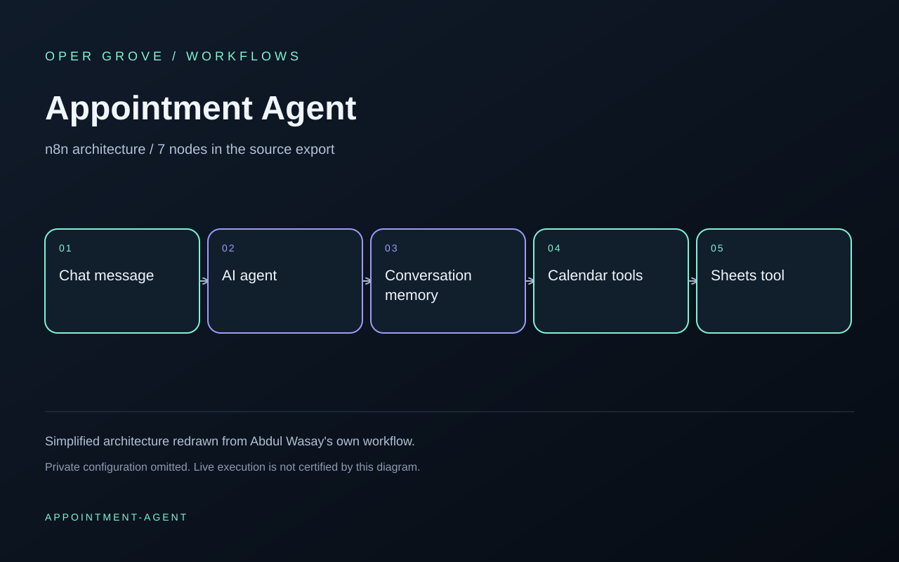

# Appointment Agent

A chat agent connects to conversation memory, a Sheets tool and Calendar lookup and creation tools.

Built by Abdul Wasay. This is a public architecture snapshot of his own n8n workflow, prepared for portfolio review in October 2026.

## What the JSON demonstrates

- The original node types, versions, positions and connection topology (7 nodes).
- Generic node names replace private labels.
- Every node parameter is intentionally empty. Credentials, prompts, pinned records, URLs, account IDs and runtime metadata are omitted.

**This is not a runnable template.** It can be inspected as architecture; it needs reviewed configuration and testing before any execution. No execution was performed while preparing this snapshot. No client names, commercial outcomes or performance metrics are claimed.

[View JSON](workflow.json) · [Opergrove portfolio](https://opergrove.vercel.app)
